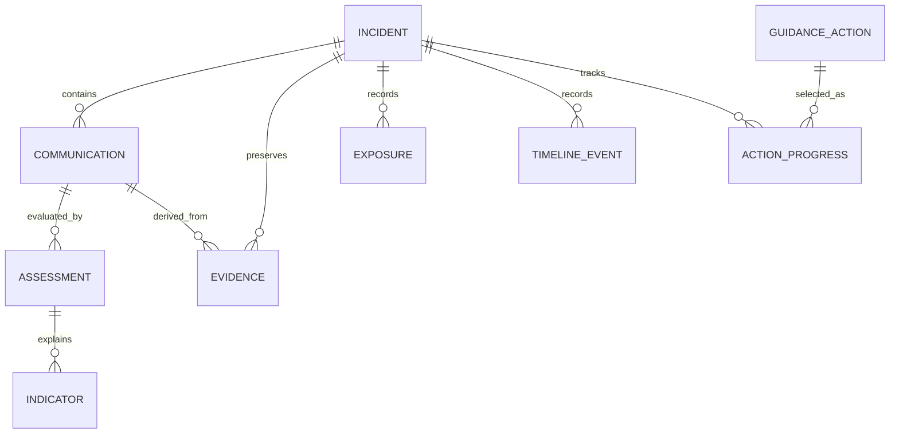

# Data model and API contracts v1

This is an internal component API. **No HTTP API, endpoint, port, authentication token or server database is deployed or needed for MVP.** Introducing HTTP requires a new ADR and OpenAPI contract before implementation. JSON schemas describe portable snapshots/export, not network transmission.

## Entity relationships

The Communication–Evidence link is optional: manually added evidence may have no communication. Each evidence item belongs to exactly one incident; a linked communication must belong to that same incident. A screenshot may produce multiple assessment versions but never mutate the original bytes. GuidanceAction is a versioned bundled catalog entry, not remotely managed state.

## Storage schema

Use random UUID primary keys. Persist timestamps as UTC epoch milliseconds plus user-entered occurrence timezone/precision in encrypted payload; display in device timezone. Device clock and user entries are not trusted forensic timestamps. All FKs are enforced; index child incident_id and assessment communication_id. No user table: Android app sandbox plus vault unlock is the local boundary.

| Entity | Columns / constraints | Sensitive encrypted payload |
| --- | --- | --- |
| Incident | id PK, created_at, updated_at, status OPEN/ARCHIVED/DELETING, wrapped_key, key_version, payload_ciphertext | title ≤120 chars, notes ≤10k, optional official reference and occurrence time |
| Communication | id PK, incident_id FK, source enum, created_at, payload_ciphertext | original text ≤20k code points, corrected text, claimed sender, provenance |
| Evidence | id PK, incident_id FK, communication_id nullable FK, storage_state STAGING/READY/DELETING, payload_ciphertext | generated relative file ID, MIME, byte count, dimensions, SHA-256 of original bytes, capture/import time, original display name |
| Assessment | id PK, communication_id FK, created_at, payload_ciphertext | contract snapshot: rule version, band, coverage, limitations, extracted URLs and indicators |
| Indicator | serialized within immutable assessment payload; no duplicate mutable table needed | ID, category, spans, rationale key |
| Exposure | incident_id FK + kind composite PK, payload_ciphertext | YES/NO/UNKNOWN, user confirmation time; never an OTP or password value |
| TimelineEvent | id PK, incident_id FK, created_at, payload_ciphertext | type CREATED/EVIDENCE_ADDED/EXPOSURE_CHANGED/ACTION_RECORDED/NOTE, user text; append-only except whole-incident deletion |
| ActionProgress | incident_id FK + action_id + guidance_version composite PK, payload_ciphertext | NOT_STARTED/DONE/SKIPPED, user-entered note and time; not verified official status |
| GuidanceAction | loaded from bundled JSON by id + version | applicability, steps, sources, checked date; public non-sensitive content |

For app-scale workloads decrypt incident titles after vault unlock to populate lists; no plaintext full-text index or cloud search. Limit default list pages to 50. Metadata leakage (counts and timestamps) remains possible on a compromised device and is documented. Room versioned migrations are required; never `fallbackToDestructiveMigration` for user evidence.

Encrypted payload and file envelope: version, keyId, 96-bit random nonce, ciphertext with 128-bit GCM tag. New nonce for every encryption with same key. AAD binds envelope version, incidentId, entity/fileId and purpose; reject swaps. Per-incident random 256-bit data key is wrapped by Android Keystore AES key. Actual key authentication/invalidation policy must be validated in #55; no homemade crypto algorithms. No plaintext originals in shared storage. Cache contains only bounded temporary data and is cleaned on cancellation/restart/expiry.

## Public component interfaces

| Interface | Input → output | Semantics / errors |
| --- | --- | --- |
| Analyzer.analyze | AnalysisInput(text, declaredLanguage, source, rulesVersion) → AnalysisResult | Pure bounded function; EMPTY_INPUT, TOO_LARGE, UNSUPPORTED_VERSION are typed validation errors; language coverage is a result, not a crash |
| ExposureRouter.route | ExposureAnswers + guidanceVersion → ordered GuidanceAction IDs | Independent from AnalysisResult. Financial loss outranks analysis. Unknown answers prompt follow-up; never treated as NO |
| OcrReader.read | validated image handle → OcrDraft(text, script, warnings) | Background/cancellable; IMAGE_INVALID, UNSUPPORTED_TYPE, TOO_LARGE, OCR_EMPTY, OCR_FAILED; no save/upload side effect |
| IncidentRepository.create | CreateIncidentCommand with client-generated id → IncidentSnapshot | Atomic logical save; repeat same id/content returns existing result, differing content returns CONFLICT |
| IncidentRepository.get/list | UUID / page cursor → snapshots | VAULT_LOCKED, NOT_FOUND, CORRUPT_DATA, KEY_UNAVAILABLE; never substitutes empty evidence for corrupt files |
| IncidentRepository.addEvidence | incidentId + staged immutable original + metadata → EvidenceId | Authenticated vault; enforce incident ownership and linked-communication consistency; bounded storage and rollback |
| IncidentRepository.delete | incidentId → deletion status | Idempotent; DELETING hidden from normal reads; durable cleanup journal |
| EvidenceExporter.prepare | selected incident/items + redaction choices → private preview package | Requires unlock; no automatic sending; redacted derivatives never replace originals |
| GuidanceCatalog.load | version → validated catalog | Bad update cannot replace a bundled working version; MVP ships bundles only, no network update |

Cancellation is explicit and discards unfinished output. File errors return actionable UI states without filesystem paths or private provider messages. Use UTF-16 offsets for Android text spans; input length limits count Unicode code points. Normalization maps spans back to displayed reviewed text; offsets must never point into different original content.

## Analysis semantics

AnalysisResult fields: schemaVersion=1, rulesVersion, band (HIGH_CONCERN/CAUTION/NO_SIGNALS/UNASSESSED), coverage (SUPPORTED/LIMITED/UNSUPPORTED), indicators, limitations. Never expose numeric probability. NO_SIGNALS copy: “No supported warning signs found. This does not confirm safety.” Unsupported content returns UNASSESSED. Limited coverage always has a reason.

Initial policy to test, not calibrated truth: explicit request to disclose OTP/password or install an APK grants a high-concern finding; account-threat/urgency paired with a credential/payment request also raises high concern. One isolated urgency/fee/link-structure signal gives caution. Repeated identical keywords do not accumulate points. Quoted warnings such as “never share your OTP” must not be matched as a disclosure request. No supported signal yields NO_SIGNALS only when coverage is supported; otherwise UNASSESSED. Thresholds/rules freeze before held-out evaluation.

URL parser accepts at most 20 candidates, each ≤2048 characters. Preserve the original and display a defanged form; parse host/scheme/userinfo with standard URI facilities. Highlight punycode/userinfo/IP-literal/unusual structure as explainable cues, not proof. HTTPS does not lower risk to safe. Shortened links are unresolved, not automatically malicious. Reject executable schemes from any navigation path. No network access; encoded separators, suffix tricks, internationalized names, malformed ports and regex worst cases require tests. APK mentions are text indicators, never attachment execution.

`contracts/analysis.schema.json`, its examples, and `contracts/guidance.json` are the shared interchange baseline. Schema changes require migration/version review. Export manifest version 1 contains incidentId, exportedAt, selected evidence items (id, generated filename, SHA-256, MIME, byte count, original/derived flag), assessment versions, and a warning that timestamps/provenance are user/app recorded. Exclude encryption keys and internal storage paths. No archive import is supported.
