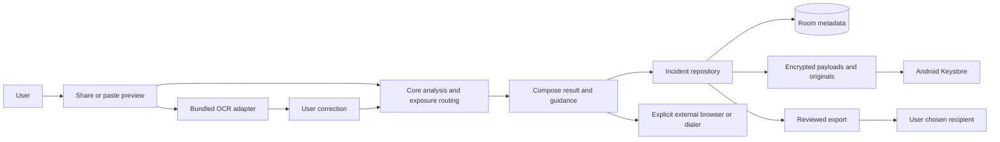
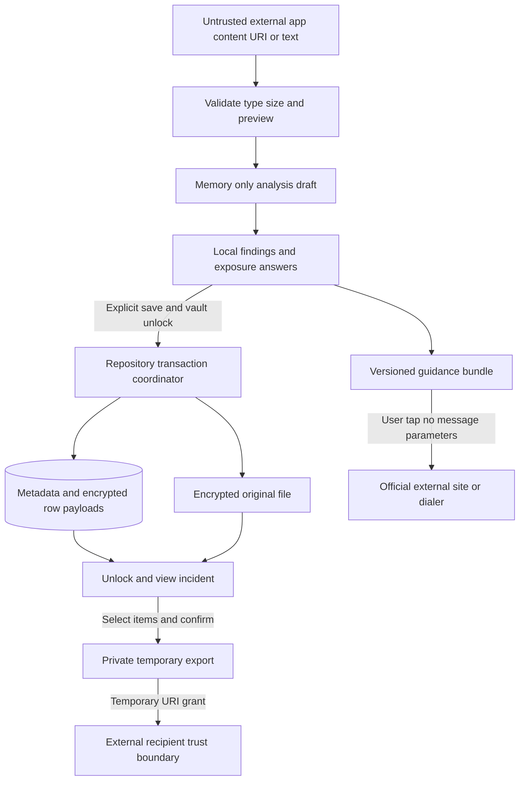

# Architecture, technology selection and ADRs

Status: recommended baseline awaiting review in #1. Date: 2026-11-25. No existing implementation constrains the choice. The old backend backlog is a planning artifact, not evidence of a technical requirement.

## Technology selection

| Concern | Alternatives and tradeoff | Decision / revisit trigger |
| --- | --- | --- |
| Android UI | Kotlin/Compose gives direct intents, lifecycle, Keystore and Android testing; Flutter adds cross-platform reach but plugin/native boundary work; React Native adds JS/native dependency surface | Kotlin/Compose; Android only. Team skill assumptions must be checked in #1 before bootstrap |
| Organization | One app with packages versus many Gradle modules | `:app`, pure Kotlin `:core`, Android `:data`; domain has no Android dependencies. Manual constructor injection initially; no DI framework requirement |
| Backend | FastAPI is accessible for future Python/model services; Ktor shares Kotlin; Firebase reduces operations but adds service/SDK dependency | None for MVP. There is no shared data or remote computation requirement. No Docker/PostgreSQL deployment just to demonstrate infrastructure |
| Database | Room/SQLite gives transactions/migrations; raw SQLite requires more mapping; PostgreSQL requires server lifecycle | Room for minimal metadata plus app-encrypted payloads; no plaintext messages in Room |
| Authentication | OAuth provider needed for future accounts; custom passwords add security burden | No service account. Device credential/biometric vault authentication, not a substitute for future server authorization |
| Text analysis | Rules are inspectable but brittle; classical classifier requires representative labels; LLM adds cost, leakage and hallucination; on-device model adds size/evaluation | Pure Kotlin deterministic findings, explicit coverage limits and abstention; ML only after benchmark evidence |
| URL analysis | Local parsing versus reputation APIs and live fetching | Local structural parsing only; no DNS, redirects, HTTP or APK fetches. Domain similarity is a future experiment due false positives and list maintenance |
| OCR | ML Kit bundled vs downloaded; Tesseract more tuning; cloud OCR leaks images and needs network | Bundled Latin ML Kit, user correction mandatory. Evaluate payload/network behavior and cold start on devices; add script packs only with language testing |
| Evidence encryption | Whole-DB SQLCipher vs encrypted payloads using platform crypto | Room stores IDs/timestamps/status only; sensitive row payloads and files use AES-GCM under per-incident keys wrapped by Keystore key. Less native packaging than SQLCipher but requires explicit transaction/recovery design |
| Offline | Local authority vs replicated offline cache and sync conflict handling | Local store is authoritative. No WorkManager sync, remote deletion or optimistic server conflicts |
| Deployment | APK beta vs backend hosting | Signed private test APK initially; Play internal testing if account available. No runtime cloud cost; developer account/distribution costs must be checked if selected |
| Monitoring | Hosted crash analytics vs local diagnostic counters | No telemetry SDK. Manual synthetic test reports and sanitized opt-in diagnostics; no user content logs |
| Testing | Unit + instrumented + device workflow | Kotlin/JUnit domain tests, Room migration tests, Compose/UI automation, hostile-content and accessibility checks; Python validates foundation artifacts only |

Reference platform evidence and unresolved feasibility checks are in [research](../research.md). Dependency versions are deliberately not invented here: #9 pins a compatible stable toolchain; #32 verifies bundled OCR artifact compatibility and licensing. Prototype payload encryption and key invalidation before committing to release (#55).

## High-level architecture

`:core` owns analysis, URL parsing, immutable contracts, exposure routing and guidance selection. It accepts plain values and produces values; it cannot read files, network, clock or UI. Pass time/version explicitly to make results reproducible.

`:data` implements Room repositories, crypto, safe image input/OCR adapters, export and curated bundle loading. It does not decide what severity means. `:app` owns navigation, ViewModels, permission/intents, lifecycle and user consent. Screens observe immutable UI state; coroutines perform bounded background work. Repositories return typed failures, never stack traces or raw provider messages to users.

One composition root constructs dependencies. No microservices, event bus or remote queue. A single owner for each issue plus rotating reviewer keeps three developers able to integrate independently against shared fixtures.

## Detailed boundaries and data flows

Untrusted content crosses into validation, never execution. Drafts stay in memory and are discarded on cancellation/process death; no automatic clipboard access. OCR uses a bounded decoded copy; original bytes are preserved separately only when the user saves. A process restart must not resurrect plaintext draft state in Android saved-instance bundles.

Save flow: vault unlock → generate incident UUID/key → encrypt immutable payload/file to private staging → commit references and metadata transaction → move/finalize staged files → mark ready. Persist a recovery journal without sensitive text. Readers only see READY items. Startup removes or finishes incomplete operations deterministically. Deletion tombstones first, revokes key access, removes rows/files/exports, and retries cleanup. Specify and test crash points in #36/#40/#55. There is no distributed transaction.

## ADR-001 — Local authority, no backend/accounts

Decision: all MVP case data belongs to one installation. Alternatives: FastAPI/PostgreSQL and managed backend. They add tokens, object authorization, transport, retention, abuse and sync without required user value. Consequence: no cross-device recovery; uninstall or key loss can destroy access. Revisit only after user demand and a funded operational owner. A future backend must require server-side owner checks on every object, scoped tokens, limits and deletion propagation; no anonymous evidence bucket.

## ADR-002 — Explanation and exposure are separate

Decision: output concern signals, not scam probability. Exposure drives urgent guidance even if classification abstains. Alternatives: single weighted score, LLM verdict, trained classifier. None establishes what the user did. Consequence: missed novel scams and benign keyword collisions remain; evaluation and plain limitations are mandatory. Rule/model changes version old assessment snapshots instead of rewriting incident history.

## ADR-003 — Selected evidence, encrypted and exportable

Decision: no inbox ingestion, content upload or automatic export. Preserve original bytes and derived text separately. Alternative: upload all evidence for convenience, or unencrypted local storage. Consequence: recovery is limited; export crosses trust boundary and cannot be recalled. Hashes detect changes relative to recorded bytes; they do not establish original sender, capture time, legal admissibility or chain of custody.

## ADR-004 — Curated response guidance

Decision: reviewed versioned guidance with official source, review date and applicability. No generative reporting procedure. Different official publication dates may disagree with live forms; link to the live portal and do not enforce stale eligibility. Bundled guidance older than 90 days shows a review-age notice and retains broad urgent help; exact procedural claims are suppressed until reviewed. Monthly maintenance is a team responsibility, not a scheduled service created by this task.

## ADR-005 — Native Android and explicit contracts

Decision: Kotlin domain API and JSON interchange fixtures, not a pretend REST service. All changes to enums/schema/limits update contracts and consumers in one reviewed PR. Unknown future export schema versions must be rejected, not silently interpreted. Current export is one-way; restore/import is excluded.
